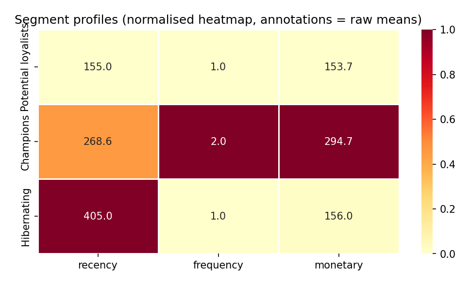
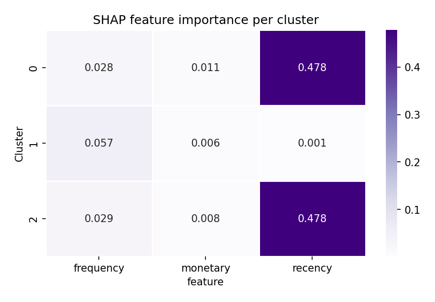
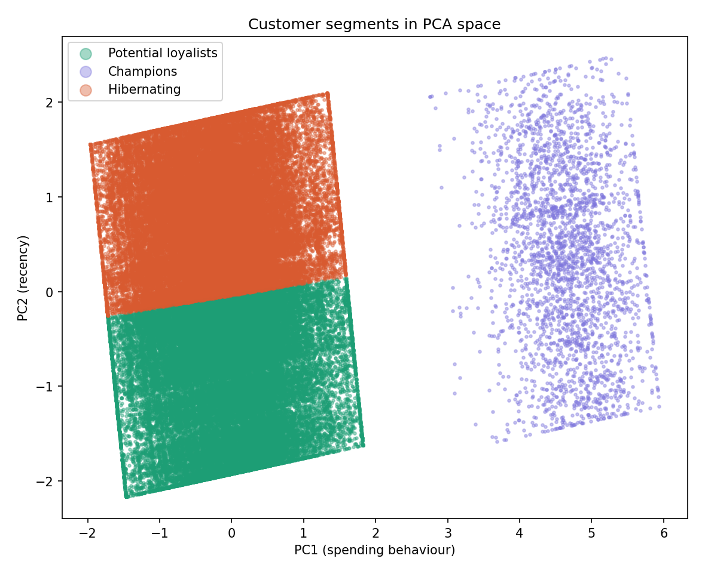
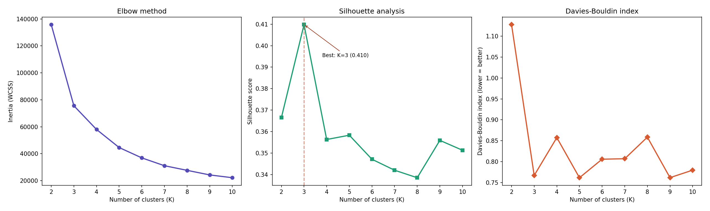

# RFM Customer Segmentation

Unsupervised customer segmentation on the [Olist Brazilian E-Commerce dataset](https://www.kaggle.com/datasets/olistbr/brazilian-ecommerce) (93,357 customers). A 4-phase pipeline — RFM feature engineering, PCA, K-Means clustering, and SHAP explainability — segments customers into three actionable groups.

| Metric | Value |
|---|---|
| Customers segmented | 93,357 |
| Segments | 3 (Champions, Potential Loyalists, Hibernating) |
| K-Means silhouette | 0.4098 |
| SHAP proxy accuracy | 99.99% (Random Forest, 5-fold CV) |
| DBSCAN benchmark | K-Means wins on silhouette (2×), Calinski-Harabasz (900×) |

---

## Pipeline

```
Raw orders ─► Phase 1: RFM Features ─► Phase 2: PCA ─► Phase 3: K-Means ─► Phase 4: Profiling + SHAP
               (aggregate, cap          (decorrelate,   (K=2..10 search,    (label segments,
                outliers, log            2D projection,   DBSCAN benchmark,   normalised thresholds,
                transform, z-score)      72% variance)    best K=3)           proxy RF + TreeSHAP)
```

```bash
python -m src.pipeline            # run all phases
python -m src.pipeline 1 2        # specific phases only
python -m src.pipeline plots      # regenerate plots only
```

---

## Results

### Three Customer Segments

| Segment | Count | % | Avg Recency (days) | Avg Frequency | Avg Monetary (BRL) |
|---|---|---|---|---|---|
| **Potential Loyalists** | 42,865 | 45.9% | 155 | 1.0 | 154 |
| **Champions** | 2,801 | 3.0% | 269 | 2.0 | 295 |
| **Hibernating** | 47,691 | 51.1% | 405 | 1.0 | 156 |



**Labels are assigned via normalised thresholds**, not arbitrary rules. Each cluster gets a recency score (inverted, 0–1) and a value score (avg of normalised frequency + monetary). A 0.5 threshold separates high from low on each axis:

- **Cluster 0** → r=1.00, v=0.00 → recent but low value → **Potential Loyalists**
- **Cluster 1** → r=0.55, v=1.00 → recent AND high value → **Champions**
- **Cluster 2** → r=0.00, v=0.01 → not recent → **Hibernating**

### SHAP Feature Importance

A proxy Random Forest (200 trees, max_depth=10) learns the K-Means labels from raw RFM features with **99.99% accuracy**, then SHAP TreeExplainer extracts per-segment feature importance:

| Segment | Recency | Frequency | Monetary | Dominant Feature |
|---|---|---|---|---|
| Potential Loyalists | **0.478** | 0.028 | 0.011 | Recency (92.6%) |
| Champions | 0.001 | **0.057** | 0.006 | Frequency (89.9%) |
| Hibernating | **0.478** | 0.029 | 0.008 | Recency (92.9%) |

**Interpretation:** Recency is the primary axis separating the two large segments (both have frequency=1, similar monetary). Frequency alone defines Champions — they're the only repeat buyers. Monetary is redundant after controlling for the other two features (<2% importance everywhere).



### Clustering in PCA Space



PC2 (recency) splits Potential Loyalists (bottom) from Hibernating (top). PC1 (spending) isolates Champions (right). This confirms the SHAP findings geometrically.

### Optimal K Selection



K=3 selected — highest silhouette (0.4098), clear elbow, near-best Davies-Bouldin. DBSCAN benchmark (silhouette=0.20, 15–40% noise) confirmed K-Means is the right choice for this data's globular cluster geometry.

---

## Project Structure

```
rfm-customer-segmentation/
├── src/
│   ├── config.py               # Constants (K_RANGE, RANDOM_STATE, REFERENCE_DATE)
│   ├── feature_engineering.py  # Phase 1: RFM aggregation, outlier capping, transforms
│   ├── pca_analysis.py         # Phase 2: correlation, PCA, component selection
│   ├── clustering.py           # Phase 3: K-Means optimisation, DBSCAN benchmark
│   ├── profiling.py            # Phase 4: profiles, labelling, SHAP explainability
│   ├── visualisation.py        # 8 diagnostic plots
│   └── pipeline.py             # Orchestrator
├── outputs/
│   ├── plots/                  # Auto-generated diagnostic plots
│   ├── segment_profiles.csv    # Final segment profiles
│   ├── clustering_metrics.csv  # K=2..10 evaluation
│   ├── shap_importance.csv     # Per-segment SHAP values
│   └── ...                     # PCA loadings, variance, centroids
├── docs/                       # Detailed PDF reports per phase
├── requirements.txt
└── data/                       # Olist CSVs (not tracked)
```

## Setup

```bash
pip install -r requirements.txt
```

Download the [Olist dataset](https://www.kaggle.com/datasets/olistbr/brazilian-ecommerce) and place CSVs in `data/`.

## Tech Stack

Python, scikit-learn (K-Means, PCA, DBSCAN), SHAP (TreeExplainer), matplotlib, seaborn, pandas

## Dataset

[Brazilian E-Commerce Public Dataset by Olist](https://www.kaggle.com/datasets/olistbr/brazilian-ecommerce) — 99,441 orders from 93,357 unique customers (Sep 2016 – Oct 2018). CC BY-NC-SA 4.0.
